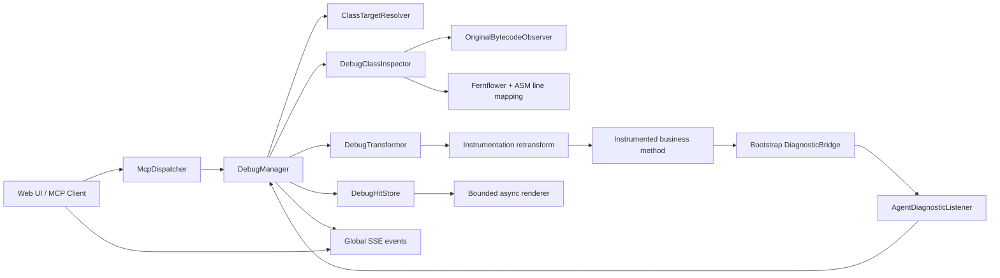

# Swapper PR #57 分析报告

## 1. 分析范围

- PR: [sunwu51/swapper#57](https://github.com/sunwu51/swapper/pull/57)
- 标题: `feat: add bounded online debug backend`
- 基线: `master` / `792590ca3e0486c52cd1327bca181dd6836b3e4f`
- 分析版本: `feat/online-debug` / `5bb93b5d182220425e2864595eeff2d7cd1f010b`
- 规模: 21 个文件，新增 4,573 行，删除 46 行
- 目标: 为已经加载且可修改的 Java 类增加“有界、非暂停”的在线行断点能力

本文基于上述 commit 的实际 diff、源码和测试进行分析。PR 关联的前端改动位于独立的 [swapper-ui#2](https://github.com/sunwu51/swapper-ui/pull/2)，不在本次 diff 内。

## 2. 结论摘要

这不是一个简单的 MCP 接口扩展，而是引入了一套完整的运行时诊断子系统。功能主链路已经打通：类搜索、运行时字节码反编译、断点定位、ASM 插桩、命中采集、异步渲染、生命周期管理、MCP 查询以及 SSE 通知均有实现。对业务控制流的保护也比较明确，`DiagnosticBridge` 会吞掉诊断回调中的异常，断点不会主动挂起业务线程。

但是当前版本不建议直接合并，建议结论为 **Request changes**。主要原因如下：

1. `OriginalBytecodeObserver` 在进程生命周期内无界缓存所有后续加载类的原始字节码，并强引用 ClassLoader，与“有界”设计目标冲突，存在长期堆增长和 ClassLoader 泄漏风险。
2. 完整测试套件不通过。JDK 8 下新增测试会制造同名类加载器歧义，导致 13 个 Online Debug 集成测试报错。
3. JDK 17 下 clean build 无法编译，`ClassFileTransformer` lambda 在该 JDK API 中不是合法的函数式接口实现。
4. 字段并非在断点命中时完成浅快照，而是在异步队列消费时才反射读取；队列积压或对象并发修改时，页面展示的字段值可能不是命中时状态。
5. 原始字节码选择优先使用 class resource，可能在 redefine、热部署或特殊 ClassLoader 场景中检查到过期或错误的字节码。

因此，这个 PR 的**功能覆盖较全面，但资源边界、跨 JDK 构建、测试隔离和快照语义仍不完整**。

## 3. 改动内容

### 3.1 新增 MCP 能力

`McpDispatcher` 增加 9 个工具：

| 工具 | 作用 |
| --- | --- |
| `search_loaded_classes` | 搜索 JVM 已加载类，返回精确 ClassLoader 标识和可修改状态 |
| `inspect_debug_class` | 获取运行时字节码的反编译源码、方法和可执行行信息 |
| `add_debug_breakpoint` | 按反编译展示行创建有 TTL 和最大命中数的断点 |
| `get_debug_breakpoint` | 查询断点状态，支持最长 30 秒 long polling |
| `list_debug_breakpoints` | 列出断点及生命周期、计数和错误信息 |
| `list_debug_hits` | 按断点列出最多 100 条保留命中摘要 |
| `get_debug_hit` | 获取参数、局部变量、字段、调用栈和返回/异常详情 |
| `remove_debug_breakpoint` | 异步卸载断点 Transformer |
| `clear_debug_history` | 清除已结束且 Transformer 已卸载的历史记录 |

MCP 仍沿用现有返回约定：工具级错误通过 `result.isError=true` 和 `structuredContent` 表达，并未改变 JSON-RPC 传输层行为。

### 3.2 运行时类检查

`DebugClassInspector` 负责：

- 取得目标类原始字节码；
- 使用 Fernflower 反编译；
- 使用 ASM 读取方法、描述符和 `LineNumberTable`；
- 将反编译展示行映射回原始字节码行；
- 排除跨方法或一对多的歧义行；
- 支持在同一个明确方法内调整到最近可执行行。

构造方法 `<init>` 和静态初始化方法 `<clinit>` 仅可检查，不支持设置断点。无行号表、反编译映射缺失、映射有歧义或类不可修改时也无法创建断点。

### 3.3 ASM 断点插桩

`DebugTransformer` 只匹配精确的类名、ClassLoader、方法名、JVM descriptor 和原始行号。它在目标方法中注入：

- 方法进入时的 `debugEnter`；
- 普通断点行的 `debugHit`；
- 断点行第一个方法调用完成或抛错后的 `debugCallHit`；
- 目标方法正常或异常退出时的 `debugExit`；
- 断点恰好位于 return/throw 行时的 `debugBreakpointExit`。

一行有多个方法调用时，只捕获第一个调用。普通行记录局部变量快照，方法调用行额外区分“被调方法参数/返回或异常”和“外层方法最终返回或异常”。

### 3.4 命中采集与存储

`DebugHitStore` 使用单线程 daemon executor 异步处理命中，主要限制如下：

| 资源 | 限制 |
| --- | ---: |
| 单条详情序列化大小 | 256 KiB |
| 保留详情总大小 | 32 MiB |
| 异步队列 | 256 |
| 对象渲染深度 | 4 |
| 单类参数/局部值数量 | 256 |
| 实例字段/静态字段数量 | 各 128 |
| 调用栈帧数 | 128 |

超出单条预算时逐级截断，超出总预算时按插入顺序淘汰旧详情。命中历史计数不会因详情被淘汰而回退。对象图采用身份检测避免当前递归路径中的循环引用。

这里的“32 MiB”只统计序列化详情大小，并不代表该功能的真实堆占用上限。`RawHit`/`Invocation` 仍可能持有返回对象或异常对象，`OriginalBytecodeObserver` 的缓存也完全不计入此预算。

### 3.5 生命周期

`DebugManager` 是进程级单例，管理断点、命中和清理任务：

- TTL 默认 600 秒，允许 60 至 3,600 秒；
- 最大命中数默认 10，允许 1 至 100；
- 全局最多 20 个活动断点；
- 每个精确 `Class<?>` 最多 5 个活动断点；
- 状态包括 `ARMED`、`DISARMING`、`DISARMED`、`ERROR`；
- 结束原因包括 `MAX_HITS`、`TTL_EXPIRED`、`USER_REMOVED`、`RESET`、`INSTALL_FAILED`；
- 终态记录默认保留 10 分钟；
- `DISARMED` 只在 Transformer 移除和回滚尝试结束后设置。

命中数使用 CAS 更新，可避免并发流量突破最大命中数。达到 TTL 或命中上限后，卸载工作通过调度线程异步执行。

### 3.6 Bridge、全局 Transformer 与事件

- `DiagnosticBridge` 新增 Online Debug 回调，并统一捕获 `Throwable`，避免诊断代码改变业务返回、异常和控制流。
- `AgentDiagnosticListener` 将 bootstrap bridge 回调转发给 `DebugManager`。
- `Global.deleteTransformerChecked` 新增可观测的卸载/回滚错误，并在移除失败时保留注册状态。
- `Global.reset()` 先重置 Online Debug，再执行原有 Transformer 全量清理。
- `Global.publishEvent()` 通过现有 SSE subscriber 发布 `DEBUG_HIT` 和 `DEBUG_BREAKPOINT` 结构化事件。
- `App` 启动时安装 `OriginalBytecodeObserver`，用于后续检查和恢复原始字节码。

## 4. 整体架构



主流程分为两段：

1. **控制面**：MCP 请求进入 `DebugManager`，精确解析 ClassLoader，检查和反编译原始字节码，创建 `DebugTransformer` 并触发 retransformation。
2. **数据面**：插桩后的业务方法调用 bootstrap 可见的 `DiagnosticBridge`；回调进入 agent 侧的 `DebugManager`，业务线程只完成有限的数据组装和入队，异步线程负责反射字段、对象树渲染、预算截断和事件发布。

该分层符合 Java Agent 的类加载约束：被插桩业务类只依赖 bootstrap bridge，不直接依赖 agent 实现类。

## 5. 对已有功能的影响

### 5.1 正向影响

- 原有 watch/trace/change 等 Transformer 可以继续复用统一的安装和卸载注册表。
- `deleteTransformerChecked` 让 Online Debug 能区分“请求卸载”和“实际完成卸载”，生命周期状态比原有 fire-and-forget 删除更准确。
- `DiagnosticBridge` 层隔离了诊断异常，降低新增功能破坏业务异常和返回值的风险。
- ClassLoader 精确定位避免同名类在多容器、插件或应用服务器场景下被错误插桩。

### 5.2 兼容性和回归面

1. `Global.deleteTransformer` 的全局语义发生变化：`Instrumentation.removeTransformer()` 返回 `false` 时不再从 registry 和 active map 删除。这会影响所有现有 Transformer，而不只是 Online Debug。旧调用方仍只记录错误，不会把失败反馈给 MCP 客户端。
2. `Global.reset()` 新增对 `DebugManager.reset()` 的调用，reset 操作现在同时终止调试记录和清空命中详情。
3. `DiagnosticListener` 的兼容注释不完全成立。大部分新增方法是 `default`，但四参数 `debugHit(...)` 是抽象方法；外部源码实现者需要新增实现。旧二进制实现被调用时产生的问题会被 bridge 吞掉，表现为静默丢失调试命中。
4. Agent 启动后常驻两个额外 Transformer，其中原始字节码 observer 会观察之后加载的每一个类。
5. SSE 连接使用无界 `LinkedBlockingQueue`。新调试事件复用了该通道，慢客户端会扩大原有无界积压风险；`offer()` 的“队列已满”分支对当前无界队列不会生效。
6. PR 没有修改 `swapper-ui` submodule 指针。仅合并后端 PR 不会交付 README 描述的 Online Debug 页面，需要前端 PR 独立合并和集成。
7. Maven 版本仍为 `0.0.18`，MCP server info 也未升级。若客户端依赖版本进行能力判断，目前无法通过版本区分该新协议面。

## 6. 代码审查发现

### 6.1 高优先级：原始字节码缓存无界并强引用 ClassLoader

位置：`src/main/java/w/core/debug/OriginalBytecodeObserver.java:19-24, 91-94, 145-166`

`INITIAL_BYTES` 会缓存 observer 安装后每一个首次加载类的完整字节码，没有容量限制、过期、按需策略或弱引用。`ClassKey` 强引用 ClassLoader，因此动态部署、插件系统、脚本或代理生成类不仅占用字节数组内存，还可能阻止整个 ClassLoader 及其类卸载。

这项风险与命中详情的 32 MiB 上限无关，生产运行时间越长影响越大。建议只按需恢复目标类字节码，或采用有明确总字节预算、淘汰策略和弱 ClassLoader 关联的缓存。

### 6.2 高优先级：完整测试套件不通过

位置：`src/test/java/w/core/debug/DebugTransformerTest.java:69-74`，`DebugManagerIntegrationTest.java:414-425`

`DebugTransformerTest` 通过自定义 `ByteArrayLoader` 定义了第二个名为 `w.core.debug.DebugTarget` 的已加载类。后续集成测试仅按类名检查目标，没有传 ClassLoader hash，因此 resolver 正确地报告同名类歧义。

在 JDK 8 完整测试中结果为：`Tests run: 111, Failures: 2, Errors: 13`。其中 13 个 error 均是这一新增测试污染导致；另 2 个 failure 是跳过前端构建后静态资源不存在。单独执行 `DebugManagerIntegrationTest` 时 15 个用例可通过，说明功能测试本身有覆盖，但套件隔离未做好。

建议让 transformer 单测使用不同类名，或确保集成测试始终传入精确 ClassLoader hash，并在 CI 中执行完整而非按类拆分的测试套件。

### 6.3 高优先级：JDK 17 clean build 编译失败

位置：`src/main/java/w/core/debug/OriginalBytecodeObserver.java:25-35`

`RECOVERY_OBSERVER` 使用 lambda 实现 `ClassFileTransformer`。在 JDK 17 的 API 中该接口没有可用于 lambda 的单一抽象方法。使用 OpenJDK 17.0.19 执行：

```text
./mvnw -Dexec.skip=true clean test
OriginalBytecodeObserver.java:[26,13] incompatible types:
java.lang.instrument.ClassFileTransformer is not a functional interface
```

项目声明 Java 8 source/target，但通常仍应能在支持的较新 JDK 上 clean build。建议改为匿名类并显式覆写旧签名，随后增加 JDK 8 与当前 LTS JDK 的构建矩阵。

### 6.4 中优先级：字段值不是命中时快照

位置：`src/main/java/w/core/debug/DebugHitStore.java:844-917` 以及字段采集逻辑

业务线程只复制参数/局部变量数组中的顶层引用，并保留 `target`。实例字段和静态字段要等单线程 capture executor 消费请求后才通过反射读取。在 256 个请求排队或对象并发变化时，字段值可能来自断点之后的时刻，甚至不同字段来自不一致时刻。

建议明确 API 语义为“异步观察值”而非“快照”，或者在业务线程上以严格上限读取一层字段引用，再异步渲染这些已捕获引用。

### 6.5 中优先级：可能使用过期或错误的 class resource

位置：`src/main/java/w/core/debug/OriginalBytecodeObserver.java:59-84, 98-113`

`capture()` 无条件优先调用 `target.getResourceAsStream()`，之后才查按 ClassLoader identity 保存的字节。class resource 可能在 redefine/热部署后过期，也可能被 parent-first 或自定义资源查找规则解析到同名但不同来源的 class。检查源码与真正 retransformation 输入不一致时，展示行、方法 descriptor 或断点行映射都可能错误。

建议优先使用与精确 `Class<?>` 关联的 observer/retransform baseline，并校验资源字节的类名、loader 来源和结构指纹。

### 6.6 中优先级：声明的详情预算不覆盖强引用对象

位置：`src/main/java/w/core/debug/DebugHitStore.java:942-1053`

`Invocation` 会保留外层方法和断点调用的返回对象或异常对象，`RawHit` 又持续引用 `Invocation`。即使参数和字段列表在渲染后被清空，大对象图仍可被返回值或 Throwable 强引用。当前 256 KiB/32 MiB 预算只根据 JSON 详情估算，无法约束这些对象的真实堆占用。

建议在渲染完成后释放原始对象引用，只保留有界的序列化表示；对尚未结束的 invocation 也应有超时和引用释放策略。

### 6.7 低优先级：SSE 背压仍然无界

位置：`src/main/java/w/Global.java:715-723`，`src/main/java/w/web/Httpd.java:231-253`

每个 SSE subscriber 使用无界 `LinkedBlockingQueue`。慢连接或网络阻塞时，日志和新增调试事件均可持续积压。建议改为有界队列，并定义丢弃旧事件、断开慢客户端或发送 resync 标记的策略。MCP polling 已经可以作为最终一致性的权威数据源。

## 7. 功能完整性评估

| 能力 | 状态 | 说明 |
| --- | --- | --- |
| 已加载类搜索 | 完成 | 支持模糊搜索、精确 ClassLoader、可修改状态 |
| 运行时源码检查 | 基本完成 | 支持反编译和行映射，但字节码来源存在一致性问题 |
| 行断点安装/卸载 | 完成 | 精确到类加载器、方法 descriptor 和原始行 |
| 非暂停业务线程 | 完成 | 不使用 suspend；bridge 隔离异常 |
| TTL/最大命中数 | 完成 | 参数校验、CAS 计数和异步卸载已实现 |
| 活动断点数量限制 | 完成 | 全局 20、单类 5 |
| 命中详情大小限制 | 部分完成 | JSON 详情有界，但被引用对象和字节码缓存无界 |
| 参数/局部变量/字段/栈 | 基本完成 | 字段读取不是命中时快照；依赖 LVT 的局部变量可能不可用 |
| 调用返回与异常 | 基本完成 | 仅捕获断点行第一个方法调用 |
| 多 ClassLoader | 基本完成 | 目标定位准确，但资源字节码可能不准确 |
| 生命周期和历史清理 | 完成 | 有终态、错误态、10 分钟保留和手动清理 |
| 实时事件 | 基本完成 | 有 SSE 通知，但无界队列缺少背压 |
| 前端闭环 | 未在本 PR 完成 | 依赖独立前端 PR，当前 submodule 未更新 |
| 跨 JDK 构建 | 未完成 | JDK 17 clean compile 失败 |
| 完整回归测试 | 未完成 | JDK 8 全套测试有 13 个新增 error |

明确不支持的能力包括：构造器和静态初始化器断点、条件断点、表达式/logpoint、暂停和单步、线程过滤、异常断点、字段 watchpoint、断点更新/启停、异步上下文传播、同一源码行多个调用的完整捕获，以及持久化事件回放。

## 8. 测试覆盖评价

PR 新增的测试覆盖了以下关键场景：

- 最大命中数自动卸载和并发计数；
- 参数、局部变量、继承字段、调用栈；
- 断点调用返回、void、异常和外层方法最终返回；
- 循环、多次命中、重复断点、历史清理；
- 歧义反编译映射；
- 不暴露 class resource 的隔离 ClassLoader；
- 单条截断、总预算淘汰、capture error；
- MCP 工具注册和不支持能力边界；
- 基础 ASM 回调注入。

仍缺少的高价值测试：

- TTL 到期的真实定时行为；
- 全局/单类活动断点上限；
- 最近可执行行调整；
- long polling 状态变化和超时；
- SSE 事件格式、慢消费者和背压；
- 真实 instrumentation 下 capture queue 饱和；
- Transformer 移除失败和字节码回滚失败；
- 无 LVT 编译产物；
- redefine 后资源字节与运行中字节不一致；
- 原始字节码缓存增长和 ClassLoader 可回收性；
- 命中后对象快速变更时的快照语义；
- JDK 8/11/17/21 clean build 和完整测试矩阵。

## 9. 合并前建议

按优先级建议完成以下事项：

1. 将 `OriginalBytecodeObserver` 改成按需、有总字节预算且不强引用 ClassLoader 的实现，并优先保证所选 `Class<?>` 与检查字节码一致。
2. 修复 `DebugTransformerTest` 的同名类污染，确保 JDK 8 完整测试套件通过。
3. 用匿名 `ClassFileTransformer` 替代 lambda，增加至少 JDK 8 和一个当前 LTS JDK 的 clean build。
4. 明确并修正字段快照语义；释放 `Invocation` 中的原始结果/异常引用，使“有界”覆盖真实保留对象，而不仅是 JSON 大小。
5. 将 SSE subscriber 队列改为有界并定义丢弃/重同步策略。
6. 将 `DiagnosticListener.debugHit(...)` 改为 `default`，或明确这是一次接口破坏并升级协议/版本。
7. 合并并固定前端 submodule 版本，补充后端和实际 UI 的端到端验证。

完成前 4 项并让完整构建矩阵通过后，该实现才具备进入生产合并评审的基础。

## 10. 最终评价

PR 在产品功能设计上是完整的：它不是只做接口或 demo，而是考虑了 ClassLoader 精确性、断点生命周期、业务线程不暂停、返回/异常保真、命中限额、历史淘汰和 UI 查询模型。4,500 多行改动中，大部分模块职责也比较清晰。

当前主要问题集中在工程边界而非功能主流程：全局无界缓存直接削弱了“bounded”承诺，字段快照语义与用户预期不一致，完整测试和较新 JDK clean build 均失败。综合判断为：**方向合理、功能链路较全面，但当前实现尚未达到可直接合并状态。**
